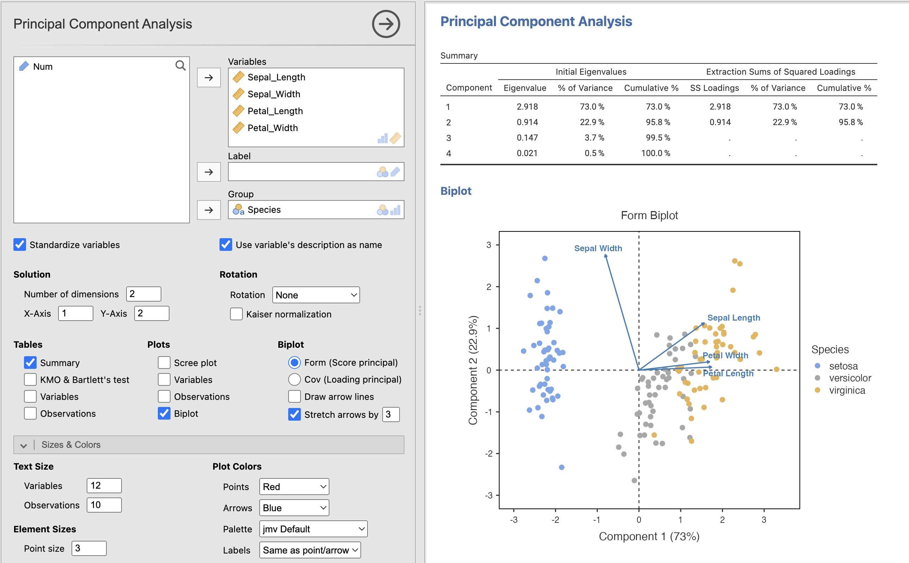
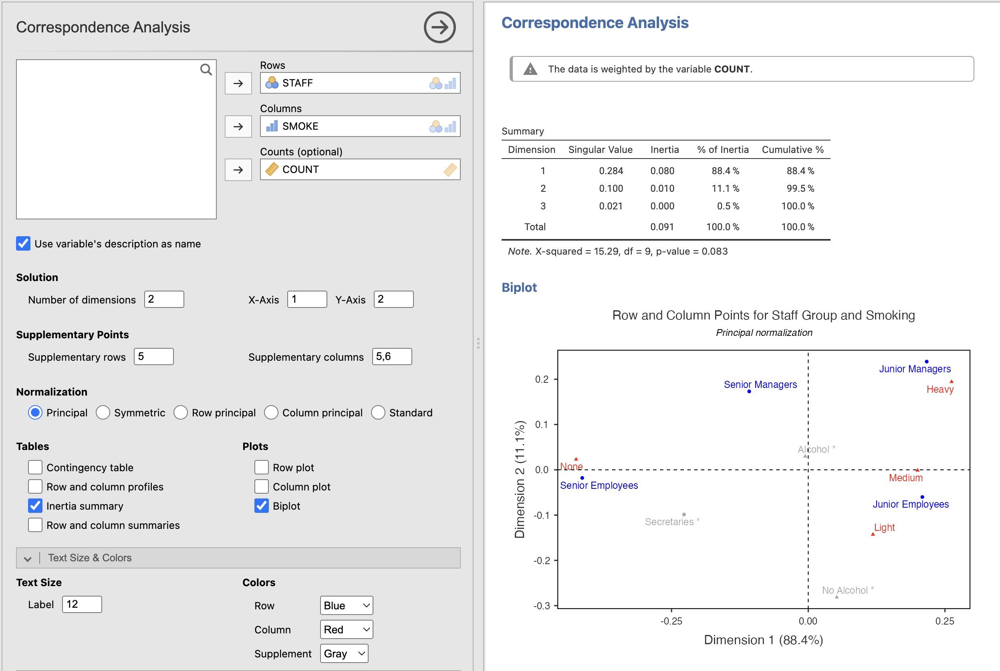
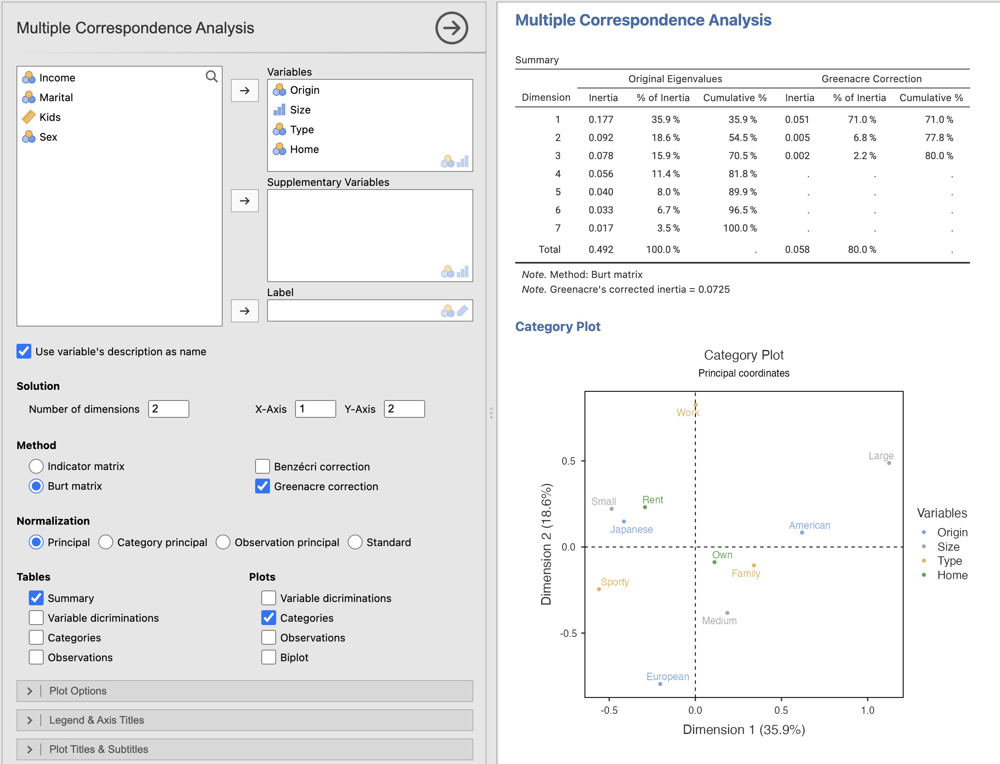

# vijMulti

A [jamovi](https://www.jamovi.org) module offering the **main classic multivariate data analyses**: 

- Principal Component Analysis
- Correspondence Analysis
- Multiple Correspondence Analysis

The module is available in the **Analyses** tab.

## Principal Component Analysis

## Correspondence Analysis

## Multiple Correspondence Analysis

## Last changes: vijMulti 1.1.2 (2026-11-11)

* More robust handling of degenerate data: dimensions with null inertia are listed but can no longer be used; constant/single-category variables are rejected
* CA: stricter validation of counts and supplementary row/column numbers; the χ² Test table shows a note when some expected counts are below 5
* PCA: plots of unstandardized variables are now scaled to the data
* PCA: KMO and Bartlett's test are left empty when the correlation matrix is singular
* PCA: a missing group is shown as "(Missing)"
* MCA: fixed an error with variable names containing spaces or special characters
* Other fixes in CA tables (supplementary columns, points at the centroid) and in French translations

See [NEWS.md](NEWS.md) for the full changelog.

## References

- Bernaards, C., Gilbert, P., Jennrich, R. (2026), GPArotation: Gradient Projection Factor Rotation. R package version 2026.4.1, <https://cran.r-project.org/package=GPArotation>
- Greenacre, M. (2010), Biplots in Practice, Fundación BBVA. <https://www.fbbva.es/en/publicaciones/biplots-in-practice-7/>
- Greenacre, M., Nenadic, O., Friendly, M.(2026), ca: Simple, Multiple and Joint Correspondence Analysis. R package version 0.72, <https://cran.r-project.org/package=ca>
- Engler, J.B. (2026). tidyplots: Tidy Plots for Scientific Papers, <https://tidyplots.org>
- Nan Xiao (2026). ggsci: Scientific Journal and Sci-Fi Themed Color Palettes, <https://nanx.me/ggsci/>
- IBM. Carbon Design System — Color palettes. <https://carbondesignsystem.com/data-visualization/color-palettes/>

